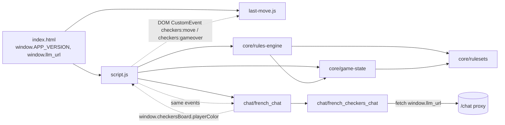
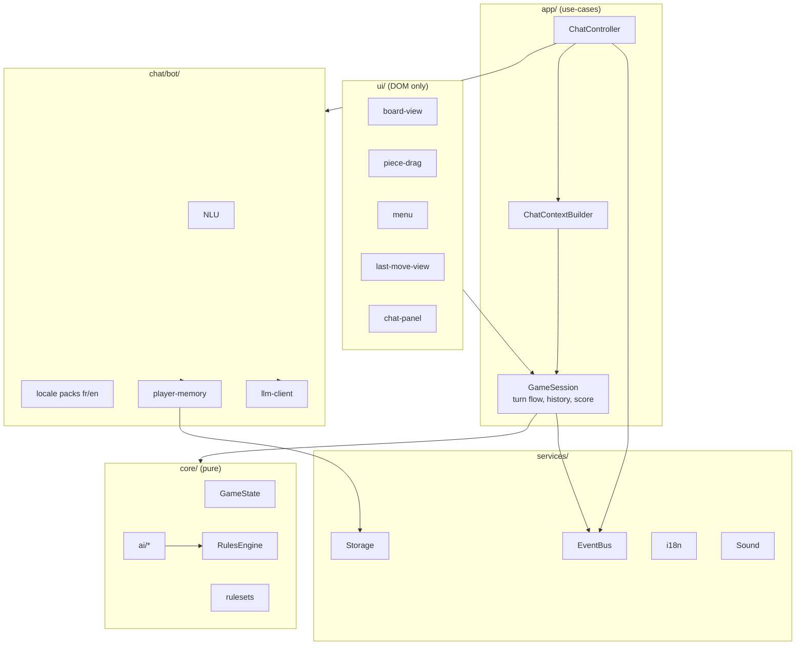

# hello-ai Checkers – Architecture Analysis & Refactoring Proposal

> Scope: the 8 files provided (`index.html`, `script.js`, `core/*`, `last-move.js`, `chat/*`).
> Not seen: CSS, audio, and the `/chat` LLM proxy (`llm_proxy_worker.js`). Statements about them are assumptions.

---

## 1. What the project is

A browser-only draughts/checkers game (British 8×8 and International 10×10) with:

- a rules engine and a serializable game state (`core/`),
- a vs-computer mode with a heuristic AI (3 difficulties),
- a French-speaking chat companion "Lucas" (rule-based NLU, optional LLM via a proxy),
- UI built by hand with DOM manipulation (no framework, no build step, ES modules loaded directly).

## 2. Current structure

```
public/
├── index.html                  bootstrap, globals (APP_VERSION, llm_url), script loading
└── assets/js/
    ├── script.js               ~1000 lines: i18n + storage + Board + Piece + Menu + bootstrap
    ├── last-move.js            classic script; last-move highlight + capture counters (DOM)
    ├── core/
    │   ├── rulesets.js         frozen config for british / international
    │   ├── game-state.js       GameState: plain-data position, applyMove()
    │   └── rules-engine.js     RulesEngine: capture paths, legal moves, validateMove
    └── chat/
        ├── french_chat.js      FrenchChat (panel UI + adapter) + conversation factory
        └── french_checkers_chat.js   SmartFrenchCheckersBot (~700 lines: NLU, replies, LLM, queue, storage)
```

### Runtime wiring



## 3. What is already good

- **`core/` is the right idea.** `GameState` is plain, JSON-serializable, has revisions (stale-move detection), and `RulesEngine` takes state in and returns options. This is the foundation for online play, AI search and tests.
- Rulesets are data (`RULESETS`) rather than `if (international)` scattered around.
- The chat is behind a `conversationFactory` and a small interface (`start`, `sendMessage`, `updateBoardState`, `setLanguage`, `triggerEvent`). That seam is exactly where you want it.
- The bot has sensible safety design: crisis detection stays local, honesty answers stay local, LLM output is filtered, there is a timeout and a fallback to built-in replies.
- Cross-module communication through events already exists (`checkers:move`, `checkers:gameover`).

## 4. Problems found

### 4.1 Separation of concerns

| # | Problem | Where | Consequence |
|---|---------|-------|-------------|
| 1 | **`script.js` is a god file.** `Board` does rendering, input/drag, turn flow, AI, sound, fullscreen, i18n, score persistence, game-over dialog. | `script.js` | Hard to test, hard to change one thing without touching others. |
| 2 | **Two sources of truth.** Position lives in `GameState`, *and* in `pieceElements[]`, `piecePositions` (WeakMap), the `occupied` attribute, and `pieceTaking` (a DOM element). | `Board` | Sync bugs; `submitMove` has to re-verify the DOM matches the state (throws "No rendered piece matches…"). |
| 3 | **Legacy mutable scratch state.** `needTake`, `takeIt`, `pieceTaking`, `movable` on DOM nodes. `checkpossibleMove` *mutates* `needTake`/`takeIt` as a side effect of being asked "what are the moves?". | `Board` | Query methods with hidden side effects. Order-dependent behavior. |
| 4 | **View state leaks into the model.** `playerColor = "piece-white"` (a CSS class) is the stored value; code repeatedly does `.slice("piece-".length)` / `.slice(6)`. | `Board`, `FrenchChat` | Magic numbers, fragile coupling between CSS naming and logic. |
| 5 | **Globals everywhere.** `board`, `chat`, `window.checkersBoard`, `window.APP_VERSION`, `window.llm_url`. `Piece`, `Menu`, `pieceClick`, `movePiece` all call the global `board`. | all | Cannot instantiate twice, cannot unit test, load order matters. |
| 6 | **Menu is built with `innerHTML` strings** and `menu.innerHTML +=` in a sequence (re-parses and drops nodes each time). | `Menu` | Fragile, hard to translate/restyle, XSS-shaped habits. |
| 7 | **i18n is inline** (`translations` in `script.js`), the chat is separately hardcoded French. | `script.js`, `french_chat.js` | Two i18n systems, no shared language source. |
| 8 | **Computer AI is inside `Board`** and reaches into the DOM (`document.getElementById(option[2])`) to score moves. | `scoreComputerMove`, `takePiece` | AI cannot run without a browser; cannot be swapped or tested. |
| 9 | **Name conflates language and persona**: `french_chat.js`, `FrenchChat`, `SmartFrenchCheckersBot`, while `setLanguage('en')` exists but the bot only speaks French. | `chat/*` | The "English" setting does not translate the chat. |

### 4.2 Chat/context problems (your main concern)

How the chat gets information **today**:

1. `FrenchChat.recordMove(move)` listens to `checkers:move` and **recomputes capture counts itself** (duplicating `captureCounts` in `last-move.js`), then calls `conversation.updateBoardState(botScore, playerScore)`.
2. `checkers:gameover` → `triggerEvent('botWin' | 'botLose')`.
3. `window.checkersBoard.playerColor` is read directly to know who is who.
4. The LLM gets `_llmContext()`: name, topics, mood, morale, turn count, games played, language, recent losses, hour.

What is missing / broken:

- **The bot defines many game events that are never triggered.** `botCapture`, `botMultiCapture`, `playerCapture`, `playerMultiCapture`, `botKing`, `playerKing` exist in `_generateEventLine`, and `startPlayerTurnTimer()` exists, but `FrenchChat` only ever fires `botWin`/`botLose`. The bot's game commentary is effectively dead code.
- **No promotion info** in the `checkers:move` event, so even if wired, king events can't be detected.
- **The LLM knows nothing about the actual game**: no ruleset, difficulty, whose turn, score, pieces left, last moves, or position. It only gets a mood derived from capture difference.
- **Context is pulled from many places**: globals, DOM events, constructor options, localStorage. There is no single "context" object.
- **Colors vs roles**: the bot needs "player" vs "computer", but events carry `white`/`black`, so each consumer re-derives the mapping.
- `FrenchChat.start()` calls `conversation.stop()` but the factory's conversation object doesn't expose `stop`/`destroy` (the bot has `destroy()`), so timers are never cleaned up if a game restarts without a page reload.

### 4.3 Smaller defects and smells

- `setRuleset()` contains **unreachable code**: after `if (this.isPlaying) { …; return; }` the next `if (!this.isPlaying || …) return;` always returns, so the block after it never runs.
- Inconsistent defaults: `GameState` defaults to `"british"`, `RulesEngine`/`rulesets.js` default to `"international"`.
- Version fallbacks disagree (`"0.26"` in core, `"0.28"` in `script.js`); `window.` vs `globalThis.`.
- **Top-level `await import(\`…?v=\`)`** in every module exists only for cache-busting. It prevents static analysis, tree-shaking, and plain Node unit tests.
- Score keys `whiteScore`/`blackScore` actually mean *player*/*computer* regardless of colour chosen.
- `removeMoving()` registers a new `document` listener on every `startGame()`.
- `this.timerIds` is declared but never used; many `setTimeout`s are not cancellable (e.g. computer move after game over/reload).
- `getMandatoryCaptures` is recomputed for every piece in `checkpossibleMove` (O(n²) per turn), and capture search clones the whole occupancy array at each step. Fine for now; a problem as soon as you want a search-based AI.
- Game over / restart uses `location.reload()`, which also tears down chat state and bot timers implicitly.
- Privacy: name and topics are stored in `localStorage` and sent to the proxy in `context`. There is no consent/notice or "forget me" UI (`forgetPlayer()` exists but is not exposed).
- Safety copy is France-specific (3114, 15, 112) and only French regex guards exist for "I am human" claims; both would be wrong/ineffective for non-French users.

## 5. Target architecture

Principle: **dependencies point inward.** `core` knows nothing about the DOM, chat, storage or language. Everything else talks to it through a session object and an event bus.



### 5.1 Proposed folder layout

```
public/assets/js/
├── main.js                      composition root: builds everything, no logic
├── config.js                    { version, llmEndpoint, defaults } – injected, not read from window
├── core/                        (pure, Node-testable)
│   ├── rulesets.js
│   ├── game-state.js
│   ├── rules-engine.js
│   └── ai/
│   │   ├── index.js             createAI(difficulty) → { chooseMove(state) }
│   │   ├── heuristics.js        today's scoreComputerMove, on GameState only
│   │   └── difficulty.js        easy/medium/hard policies
├── app/
│   ├── game-session.js          owns GameState, turn order, history, outcome, emits events
│   ├── game-events.js           event names + payload shapes (JSDoc typedefs)
│   └── chat-context.js          builds the ChatContext snapshot (see 5.3)
├── services/
│   ├── event-bus.js
│   ├── storage.js               the existing storage wrapper
│   ├── i18n.js                  one translation system for UI *and* chat
│   └── sound.js
├── ui/
│   ├── board-view.js            renders GameState → DOM (single direction)
│   ├── piece-drag.js            pointer logic, emits {from,to} intents
│   ├── menu/                    menu.js, setup.js, options.js, rules.js, results.js
│   ├── last-move-view.js        today's last-move.js, subscribed to the bus
│   └── chat-panel.js            today's FrenchChat DOM half
├── chat/
│   ├── chat-controller.js       glue: bus → bot, panel ↔ bot
│   ├── bot-port.js              the interface the controller depends on (JSDoc)
│   └── bot/
│       ├── companion-bot.js     orchestration only
│       ├── nlu.js               normalize + intent scoring
│       ├── lexicon.fr.js / lexicon.en.js
│       ├── replies.fr.js / replies.en.js   topics, events, openers
│       ├── player-memory.js     name/topics/stats (localStorage)
│       ├── message-queue.js     typing simulation, priorities
│       ├── llm-client.js        fetch + timeout + sanitising
│       └── safety.js            crisis detection + locale-specific resources
└── locales/ en.json, fr.json
```

### 5.2 Key design moves

1. **`GameSession` becomes the single owner of game state.** UI sends *intents* (`session.tryMove(from, to)`), the AI asks for a move (`ai.chooseMove(session.state)`), and the session emits events. The DOM is rendered *from* the state (`boardView.render(state)`); no `pieceElements` / `piecePositions` / `occupied` bookkeeping, no `needTake` / `takeIt`. Query methods return values and have no side effects (`session.getLegalMoves(from)`).
2. **Roles, not colours, at the boundary.** The session knows `humanColor`; events and chat context say `player` / `computer`. No more `"piece-white".slice(6)`.
3. **One event bus** (a 20-line wrapper around `EventTarget`, or a tiny pub/sub) instead of ad-hoc `CustomEvent`s on `document`. Keep dispatching to `document` only if external code needs it.
4. **One i18n service** shared by UI and bot. The bot's language packs (`replies.fr.js`, `replies.en.js`, `lexicon.*`) are selected by `i18n.language`; the persona and the language are separate concepts (rename `FrenchChat` → `ChatPanel`/`ChatController`, `SmartFrenchCheckersBot` → `CompanionBot`).
5. **Composition root (`main.js`)** instantiates `Storage`, `I18n`, `EventBus`, `GameSession`, views and chat, and passes dependencies explicitly. No globals, `window.checkersBoard` disappears.
6. **Cache-busting without top-level await**: use static `import`s and either an import map (`<script type="importmap">` with versioned URLs) or a one-step bundler (Vite/esbuild with hashed filenames). That also makes `core/` runnable under `node --test`.

### 5.3 Making context easy to pass to the chat

Goal: the chat (rule-based or LLM) can always ask **"what is going on right now?"** and subscribe to **"what just happened?"**, without reaching into globals or the DOM.

**a) A pull API: one snapshot object**

```js
// app/chat-context.js
/**
 * @typedef {Object} ChatContext
 * @property {{ruleset:string, difficulty:string, status:'idle'|'playing'|'over',
 *   turn:'player'|'computer', moveNumber:number,
 *   score:{player:number, computer:number},            // captures this game
 *   material:{player:{men:number,kings:number}, computer:{men:number,kings:number}},
 *   lastMoves:Array<{by:'player'|'computer', from:string, to:string, captures:number}>,
 *   position:string}} game                              // compact notation, e.g. PDN/FEN-like
 * @property {{name:string|null, topics:string[], morale:'low'|'neutral'|'good',
 *   gamesPlayed:number, lossStreak:number}} player
 * @property {{language:'fr'|'en', hour:number, recentDistress:boolean}} session
 */
export function createChatContextBuilder({ session, memory, i18n, now = () => new Date() }) {
  return {
    build() {
      const s = session.snapshot();            // plain data from GameSession
      return {
        game: {
          ruleset: s.ruleset, difficulty: s.difficulty, status: s.status,
          turn: s.turnRole, moveNumber: s.moveNumber,
          score: s.captureScore, material: s.material,
          lastMoves: s.history.slice(-4),
          position: s.notation
        },
        player: memory.publicProfile(),        // whitelist – no free text
        session: { language: i18n.language, hour: now().getHours(), recentDistress: memory.recentDistress() }
      };
    }
  };
}
```

**b) A push API: typed domain events with everything a consumer needs**

```js
// app/game-events.js
/** @typedef {{type:'move',    by:'player'|'computer', from:number, to:number,
 *             captures:number, promoted:boolean, turnCompleted:boolean}} MoveEvent */
/** @typedef {{type:'turn',    turn:'player'|'computer'}} TurnEvent */
/** @typedef {{type:'gameover', winner:'player'|'computer'|'draw', reason:'pieces'|'no-moves'}} GameOverEvent */
```

`GameSession` emits these; `last-move-view`, `sound`, `capture-counter` and the chat all subscribe. The score is computed **once** in the session (not in both `last-move.js` and `FrenchChat`).

**c) The controller maps events → bot, and injects context**

```js
// chat/chat-controller.js
export class ChatController {
  constructor({ bus, panel, createBot, contextBuilder }) {
    this.bot = createBot({ getContext: () => contextBuilder.build(), onMessage: m => panel.addComputerMessage(m) });
    bus.on('game:move', e => {
      if (e.captures > 1) this.bot.onGameEvent(e.by === 'player' ? 'playerMultiCapture' : 'botMultiCapture');
      else if (e.captures === 1) this.bot.onGameEvent(e.by === 'player' ? 'playerCapture' : 'botCapture');
      if (e.promoted) this.bot.onGameEvent(e.by === 'player' ? 'playerKing' : 'botKing');
      if (e.turnCompleted && e.by === 'computer') this.bot.startPlayerTurnTimer();
    });
    bus.on('game:over', e => this.bot.onGameEvent(e.winner === 'player' ? 'botLose' : 'botWin', true));
    panel.onSubmit(text => this.bot.receivePlayerMessage(text));
  }
  dispose() { this.bot.destroy(); }
}
```

**d) The bot depends on a *port*, not on the game**

```js
/** @typedef {Object} BotPort
 *  @property {(text:string)=>void} receivePlayerMessage
 *  @property {(name:string, force?:boolean)=>void} onGameEvent
 *  @property {()=>void} startPlayerTurnTimer
 *  @property {(lang:'fr'|'en')=>void} setLanguage
 *  @property {()=>void} destroy
 */
```

Inside the bot, `_llmContext()` simply becomes `{ ...this.getContext(), bot: { name, mood } }`, and the proxy receives game facts (turn, score, material, last moves) in addition to the emotional state. That lets the LLM say "nice capture on your last move" or "you're ahead by two pieces" truthfully.

**e) Rules for what goes into the context** (keeps it clean and safe)

- Plain JSON only, whitelisted fields, bounded sizes (history ≤ 4 moves, strings ≤ 600 chars, as `_remember` already does).
- No raw DOM, no colours-as-CSS-classes, no `window` access.
- Treat the player's free text as untrusted data in the proxy's system prompt; never let it override the persona or safety rules.
- Anything stored about the player goes through `memory.publicProfile()` so it is obvious what is shared with the proxy; add a visible "forget me" action wired to `forgetPlayer()`.

## 6. Migration plan (incremental, each step shippable)

**Phase 0 – Quick wins, no restructuring (≈ half a day)**
1. Add `promoted` (and `mover` role) to the `checkers:move` event detail in `submitMove`.
2. In `FrenchChat.recordMove`, trigger the existing events (`botCapture`, `playerCapture`, `*MultiCapture`, `*King`) and call `startPlayerTurnTimer()` when the computer finishes a turn. This revives dead bot code.
3. Add `contextProvider` to the bot options, merge it into `_llmContext()`; implement `board.getChatContext()` returning ruleset/difficulty/turn/score/material/last moves.
4. Expose `destroy()` on the conversation object returned by the factory and call it in `FrenchChat.start()` (instead of the non-existent `stop`).
5. Delete the unreachable block in `setRuleset`; align default rulesets; unify the version fallback; remove unused `timerIds`.

**Phase 1 – Extract pure pieces from `script.js`**
- `services/storage.js`, `services/i18n.js` + `locales/*.json`, `services/sound.js`.
- `core/ai/*`: move `scoreComputerMove`, move selection and difficulty randomness; they only use `GameState` + `RulesEngine`.
- Add unit tests for `core/` (see section 7).

**Phase 2 – Introduce `GameSession` and `EventBus`**
- Move turn flow, history, outcome and score out of `Board`. `Board` shrinks to `BoardView` + input.
- Replace `needTake`/`takeIt`/`pieceTaking` with `session.getLegalMoves(from)` and `session.mustContinueWith`.
- Move `last-move.js` to `ui/last-move-view.js`, subscribe via the bus (becomes a module, shares the score from the session).

**Phase 3 – Split the chat**
- Rename files/classes by role (`ChatPanel`, `ChatController`, `CompanionBot`).
- Split the bot into `nlu`, `safety`, `memory`, `message-queue`, `llm-client`, and `replies.<lang>`.
- Add English packs so the language option actually changes the chat; make crisis resources locale-aware.

**Phase 4 – Composition root and tooling**
- `main.js` wires everything; remove `window.checkersBoard`, `window.llm_url`, global `board`/`chat`.
- Replace top-level-await cache-busting with an import map or Vite build.
- Optional: replace `innerHTML` menus with small view functions / `<template>` elements.

## 7. Testing recommendations

- **`core/` first**: with static imports it runs under `node --test`. Cases worth having: man/king captures in both rulesets, mandatory longest capture (international), deferred removal of captured pieces (can't jump the same piece twice, Turkish-strike rule), promotion mid-capture (no promotion if the capture continues backwards in international; stop on promotion in British), stale `revision`, `continuationSquare` enforcement, no-legal-moves = loss.
- **AI**: deterministic seeds → same move; never returns an illegal move; always takes a mandatory capture.
- **Bot**: table tests on `_analyzeInput` (negation "je ne suis pas triste", "mourir de rire"), crisis detection, name extraction, queue priority behaviour, LLM fallback on timeout / non-OK / rejected reply.
- **Context builder**: snapshot test to guarantee the whitelist (no unexpected fields leave the browser).

## 8. Performance notes (for when an AI with lookahead is added)

- Cache `getMandatoryCaptures` per `state.revision`.
- Capture search clones `occupancy` repeatedly; switch to make/unmake on a single mutable array, or a typed array/bitboard representation for the AI path only.
- Keep `GameState` (immutable-ish, serializable) as the public format; use a faster internal board inside `core/ai`.

## 9. Summary: top 5 actions

1. Wire the existing bot events and pass a game-aware context (Phase 0) – largest visible gain for the smallest change.
2. Make `GameSession` the single owner of state; render DOM from state; delete the DOM-side bookkeeping.
3. Introduce an event bus with typed events using `player`/`computer` roles; stop reading `window.checkersBoard`.
4. Separate persona from language; one i18n service; split the 700-line bot into focused modules.
5. Move AI into `core/ai` and add Node tests for `core/` – this is what makes every later change safe.
